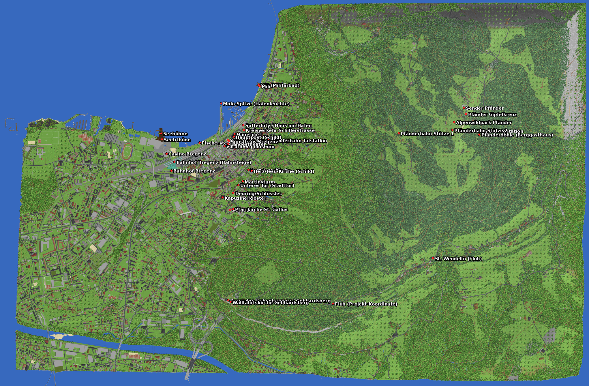

# Bregenz 1:1 – Minecraft Java World

Bregenz im Maßstab **1 Block = 1 Meter**. **Y ist die echte Höhe über Adria**:
der Bodensee liegt auf Y=396, die Oberstadt auf Y≈425, Fluh auf ≈720 und der Pfänder-Gipfel auf **Y=1062**.
Der Nullpunkt (0 / 0) liegt im **vorarlberg museum** am Kornmarktplatz.



## Was drin ist

| | |
|---|---|
| **Gelände** | Offizielles 10-m-Geländemodell Österreich (über AWS Terrain Tiles), bikubisch auf 1 m interpoliert, plus Mikro-Relief in Wald und Wiese. Bodensee mit Uferzone und Seegrund (bis Y=380), Bregenzer Ach, Bäche, Teiche und Becken. |
| **Gebäude** | ~4.900 echte OSM-Grundrisse (Overture Maps). Die Höhe kommt aus der Stockwerkszahl: OSM-Geschosse oder aus der (systematisch zu niedrigen) Overture-Höhe geschätzt, 3 m pro Geschoss plus Dach. Altstadt und Oberstadt bekommen Pastellfassaden mit steilen Satteldächern. Dazu fünf Fenstertypen, Faschen, Sockel und Balkone. Fundament am Hang, Stockwerke alle 3 Blöcke, Fensterbänder, Tür zur nächsten Straße, Walm-, Sattel- oder Flachdach, unsichtbare Lichtblöcke innen (kein Mob-Spawn in Häusern). |
| **Verkehr** | Alle Straßen nach Klasse (Breite und Belag), Mittelmarkierung auf Hauptstraßen, Brücken mit Geländer und mindestens 6 Blöcken lichter Höhe über kreuzenden Straßen und Bahn, befahrbare Tunnel (Citytunnel, beide Röhren des Pfändertunnels) mit Gewölbe, Licht, Portalen und Stützwänden, Bahnstrecke mit echten Schienen auf Schotterbett, Bahnsteige, Straßenlaternen. |
| **Details** | Aus OSM: Bänke, Mülleimer, Bushaltestellen mit Glas-Wartehäuschen, Brunnen, Hecken, Mauern, Zäune (korrekt verbunden), Zebrastreifen, Poller, Ampeln, Fahrleitungsmasten, Hochspannungsmasten mit Leitungen, Sportplätze mit Linien und Toren, Spielplätze mit Schaukel und Rutsche, Fahrradständer. Dächer mit Treppenstufen, Traufe und Kaminen, Flachdächer mit Technik und Oberlichtern, vereinzelt Gründächer mit Kiesrand, Gesimse und Fensterläden. |
| **Natur** | Wälder aus OSM: Buche/Eiche unten, Fichte nach oben zunehmend. Einzelbäume und Baumreihen aus OSM, Parks, Almwiesen mit Blumen, Felskanten (Nagelfluh-Mix) an steilen Stellen und OSM-Klippen. |
| **Landmarks** | Seebühne (Clownskopf + Ballon) mit Seetribüne, Festspielhaus, Fischersteg mit Pavillon, Hafen mit 4 Kursschiffen (inkl. Sonnenkönigin), ~100 Booten in der Marina, Stahl-Doppelmasten auf den Molenköpfen und gepflasterter Hafenpromenade, Hauptpost (gelber Palast, Mansarddächer, Uhrturm, Antennenmast), Herz-Jesu-Kirche (Backstein, Doppeltürme mit Kupferspitzen, Rosette), Molo mit Allee, Geländer und Doppelsäulen-Leuchte, Bahnhof (Busbahnhof-Dach, Empfangsgebäude, Bahnsteigdächer, Fußgängerbrücke mit Glasturm), Casino mit zwei Kuppeln, Kreisverkehr Schillerstraße (bepflanzte Insel), Haus am Hafen (dunkle Holz-Kuben auf Stützen über dem grün verglasten Sutterlüty, Dachbegrünung), HTL mit Lamellenfassade, Mili (Pfahlbau mit grünen Läden und Steg), KUB (Glaswürfel), vorarlberg museum (Relief-Fassade, Goldpaneel), Landestheater, Martinsturm (Zwiebelkuppel), Unteres Tor (Durchgang), Deuring-Schlössle, Altes Rathaus (Fachwerk), St. Gallus (Turm mit Uhr), Kapuzinerkloster, Gebhardsberg (Ringmauer entlang der Felskante mit Breschen und Tor, Palas-Ruine an der Wallfahrtskirche, Burgrestaurant mit Seeterrasse), alle Kirchen mit Innenausstattung (Bänke, Altar mit Retabel und Kerzen, Kanzel, Orgelempore, Kronleuchter, Fresken in den Barockkirchen), Glockentürme bzw. Dachreiter, Casino-Stadion (Rasen, Laufbahn, Tribünen, Flutlicht), Sportplätze nach Sportart, Pfänderbahn (Talstation, Bergstation auf 1023 m als weißer Kubus mit Glashalle, Schindel-Geschoss, Dachterrasse und Außentreppe, 2 braune Stahl-Gitterportale, 4 Tragseile, 2 blau-weiße Kabinen mit Gehänge), Sender Pfänder (95 m), Gipfelkreuz, Alpenwildpark, Pfänderdohle, St. Wendelin in Fluh, Hafenlicht, alle Stege und Molen. Schilder an den wichtigsten Orten. |

## Installation (Java Edition 26.3)

1. `Bregenz_1zu1.zip` entpacken nach `%appdata%\.minecraft\saves\` (Windows) bzw. `~/Library/Application Support/minecraft/saves/` (macOS).
2. Minecraft **Java 26.3** starten und die Welt öffnen. Den Hinweis „ältere Version“ mit **Laden** bestätigen. Die Chunks liegen im 1.21.4-Format und werden beim Laden automatisch hochkonvertiert. Das ist der stabilste Weg.
3. Du startest im Kreativmodus mit Cheats auf der Seepromenade beim Hafen. Im Inventar:
   - **4 Karten** (Stadt & See, Pfänder, Innenstadt & Hafen, Oberstadt). Die Übersichtskarte bekommst du automatisch zurück, wenn sie fehlt.
   - **Buch „Bregenz Teleporter“**: einen Ort anklicken, und du wirst teleportiert.
4. Teleport-Befehle: `/function bregenz:hilfe` listet alle Orte, `/function bregenz:tp/<ort>` teleportiert (z. B. `bregenz:tp/martinsturm`), `/function bregenz:karten` gibt alle Karten. Alles steht auch in `KOORDINATEN.txt`.

**Wichtig:** Die Welt braucht das mitgelieferte Datapack (`datapacks/bregenz`). Es erweitert die Overworld auf **Y −64 bis 1215**. Ohne das Datapack wäre bei Y=320 Schluss.

Einstellungen, die sich lohnen: Sichtweite 16+ Chunks. Der Pfänder ist 650 m höher als die Stadt. Die Wolken hängen bei Y=760, mitten am Hang. Vom Gipfel aus schaust du auf ein Nebelmeer. Die Höhe änderst du in `config.CLOUD_HEIGHT`.

## Selbst generieren

```bash
pip install numpy scipy pillow shapely pyarrow matplotlib
python -m bregenz.fetch                # Geodaten laden (liegen schon in data/raw)
python generate.py                     # ~5 min, 4 Kerne -> output/Bregenz_1zu1 (+ .zip)
python generate.py --bbox 9.733 47.497 9.756 47.509 --out output/test   # nur Innenstadt, ~25 s
python -m pytest tests                 # Formattests (NBT, Bit-Packing, Region, Datapack, level.dat)
python tools/iso_render.py output/Bregenz_1zu1 170 415 380 215 470 425 martinsturm.png   # 3D-Ansicht aus den .mca-Dateien
```

## Aufbau

```
bregenz/
  config.py      Ausschnitt, Ursprung, Wasserspiegel, Welthöhe, Versionen
  fetch.py       Download: Terrarium-DEM (z15) + Overture Maps (S3, BBox-Filter)
  geo.py         Projektion lon/lat -> Block (Ost = +X, Süd = +Z)
  terrain.py     Höhenmodell, See + Bathymetrie, Flüsse, Bäche, Oberflächen, Biome
  roads.py       Straßen, Markierungen, Brücken, Bahn (4-verbundene Schienen mit Kurven/Steigungen)
  buildings.py   Generator für alle Grundrisse (Styles für Landmarks)
  landmarks.py   Handgebaute Wahrzeichen + Schilder
  details.py     Stadtmobiliar & Kleinkram aus OSM (Bänke, Hecken, Zebrastreifen, Masten, Sportplätze ...)
  harbour.py     Hafen: Kursschiffe, Marina-Boote, Hafenleuchten, Promenade
  vegetation.py  Bäume (vektorisiert), Bodendecker, Blumen
  world.py       Spaltenmodell + sortierte Block-Edits, Chunk-Assembler
  anvil.py       Chunk-/Region-Writer (Anvil, 1.18+-Sektionsformat)
  nbt.py         NBT-Encoder/Decoder
  level.py       level.dat + Datapack (Dimension-Type, 4 Bregenz-Biome)
  render.py      Karten-Previews + Höhenprofil
tools/iso_render.py   Isometrischer Renderer, liest die fertigen .mca-Dateien
data/raw/        gecachte Geodaten     data/plan/   Planungsprofil + Bauplan
```

### Technische Entscheidungen

* **Welthöhe 1280** (Y −64…1215) über einen Dimension-Type-Override, abgeleitet aus der Vanilla-Datei von 26.3. Nur Höhe und Wolken sind geändert.
* **Eigene Biome** mit Temperatur 1.6 und festen Gras- und Laubfarben. Vanilla senkt die Temperatur ab Y=80 pro Block. Mit normalen Biomen würde es am Pfänder schneien und der Bodensee bei Y=396 zufrieren.
* **Außerhalb der Karte** liegt ein flacher Bodensee auf Y=396 (Flat-Generator). Die Kartenränder laufen über 320 Blöcke sanft ins Wasser aus, die Weltgrenze umschließt die Karte.
* **Licht und Heightmaps** berechnet Minecraft beim ersten Laden selbst (`isLightOn=0`, Heightmaps leer). Das spart Speicher und vermeidet Lichtfehler.

## Quellen

* Höhen: Mapzen/AWS Terrain Tiles. Für Österreich basieren sie auf dem Digitalen Geländemodell 10 m (data.gv.at, CC BY 4.0).
* Karte: Overture Maps Foundation, Release 2026-10-21. Gebäude, Straßen und Landnutzung stammen aus © OpenStreetMap contributors (ODbL).
