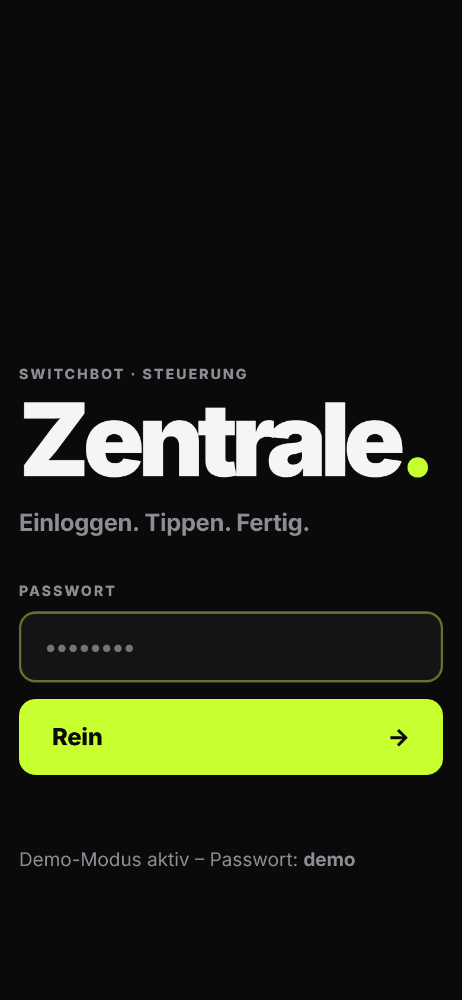
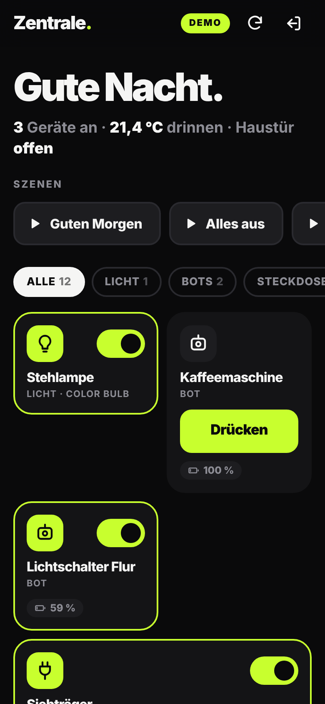
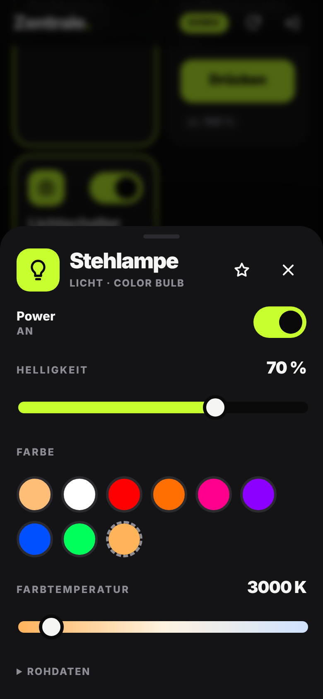
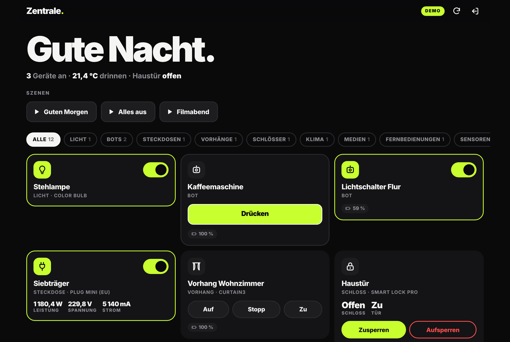

# Zentrale.

**Deine SwitchBot-Geräte im Browser. Einloggen, tippen, fertig.**

Eine Webseite, die sich wie eine App anfühlt: Passwort rein, alle Geräte da. Bots drücken, Steckdosen schalten, Licht dimmen, Vorhänge fahren, Tür zusperren, Szenen starten. Läuft am Handy, Tablet und PC. Nichts installieren. Wer will, legt sie auf den Homescreen, dann startet sie im Vollbild wie eine echte App.

<p>
  
  
  
</p>



---

## Was sie kann

| | |
|---|---|
| **Login** | Ein Passwort, du bleibst 30 Tage eingeloggt. Nach 5 Fehlversuchen ist die IP 15 min gesperrt. |
| **Alle Geräte** | Physische Geräte + IR-Fernbedienungen aus deinem SwitchBot-Account, automatisch erkannt. |
| **Bot** | Großer „Drücken“-Button im Drück-Modus, Schalter im Schalter-Modus. Erkennt den Modus selbst. |
| **Steckdosen & Relais** | An/Aus, Leistung (W), Spannung, Strom, Verbrauch heute. |
| **Licht** | An/Aus, Helligkeit, Farbe (Presets + Farbwähler), Farbtemperatur. |
| **Vorhang / Rollo / Jalousie** | Auf / Stopp / Zu + Positionsregler. |
| **Schloss** | Zu-/Aufsperren (Aufsperren mit Sicherheitsabfrage), Tür-Status. |
| **Klima** | Ventilatoren, Luftbefeuchter, Luftreiniger, Heizkörper-Thermostat. |
| **Saugroboter** | Start, Pause, zur Station, Saugstärke. |
| **Sensoren** | Temperatur, Luftfeuchte, CO₂ (Warnung ab 1500 ppm), Kontakt, Bewegung, Wasserleck. |
| **IR-Fernbedienungen** | TV (Lautstärke, Kanal), Klimaanlage (Temperatur, Modus, Lüfter), Lautsprecher, Ventilator, Licht. Eigene angelernte Tasten per Name, die Zentrale merkt sie sich. |
| **Szenen** | Alle manuellen Szenen aus der App mit einem Tap. |
| **Extras** | Favoriten, Filter nach Kategorie, Dark/Light automatisch, Akku-Warnung, Zusammenfassung oben („3 Geräte an · 21,4 °C drinnen · Haustür zu“). |

Unterstützt **jeden Gerätetyp aus der offiziellen SwitchBot-API v1.1**: 80+ Typen, alle getestet. Kennt die Zentrale einen neuen Typ noch nicht, zeigt sie trotzdem den Status und bietet einen Expertenbefehl an.

---

## Setup (einmalig, ~10 Minuten)

### 1. Token & Secret aus der SwitchBot-App holen

1. SwitchBot-App → **Profil** → **Einstellungen**
2. **10× auf „App-Version“ tippen** → es erscheinen die **Entwickleroptionen**
3. **Token** und **Secret** kopieren

Wichtig: Für Bots, Vorhänge, Schlösser & Co. muss in der App beim jeweiligen Gerät **Cloud Service** an sein, und sie brauchen einen **Hub**. Ohne Hub kommt kein Befehl aus dem Internet beim Gerät an.

### 2. Online stellen – Weg A oder B

**Weg A: Cloudflare (empfohlen).** Gratis, immer online, kein eigener Rechner nötig, HTTPS inklusive.

**Weg B: Eigener Rechner / Raspberry Pi / NAS.** Volle Kontrolle, läuft aber nur, solange das Gerät an ist. Für Zugriff von unterwegs brauchst du zusätzlich einen Tunnel.

---

### Weg A: Cloudflare Workers (gratis)

Du brauchst einen kostenlosen Account auf [cloudflare.com](https://dash.cloudflare.com/sign-up) und Node.js.

```powershell
# Node.js installieren (Windows)
winget install OpenJS.NodeJS.LTS

# Repo holen und in den Ordner wechseln
git clone https://github.com/KimJongUnNK/KimJongUnNK.git
cd KimJongUnNK/switchbot

# Bei Cloudflare einloggen (öffnet den Browser)
npx wrangler@4 login

# Hochladen
npx wrangler@4 deploy

# Zugangsdaten hinterlegen (je einmal einfügen + Enter)
npx wrangler@4 secret put SWITCHBOT_TOKEN
npx wrangler@4 secret put SWITCHBOT_SECRET
npx wrangler@4 secret put APP_PASSWORD
```

Fertig. Deine URL steht in der Ausgabe von `deploy`, z. B. `https://zentrale.dein-name.workers.dev`. Öffnen, Passwort rein, läuft.

Die Secrets liegen verschlüsselt bei Cloudflare, nicht im Code. Das Gratis-Kontingent (100.000 Requests/Tag) reicht locker.

> Eigene Domain? Im Cloudflare-Dashboard unter *Workers → zentrale → Settings → Domains & Routes* eintragen.

### Weg B: Eigener Rechner

```powershell
cd KimJongUnNK/switchbot
copy .env.example .env     # macOS/Linux: cp .env.example .env
notepad .env               # Token, Secret, Passwort eintragen
npm start
```

Dann im Browser auf `http://localhost:8787`, im WLAN auf `http://<IP-des-Rechners>:8787`. Keine Dependencies, `npm install` brauchst du nicht.

**Von unterwegs:** [Tailscale](https://tailscale.com) (am einfachsten, nur deine Geräte) oder ein [Cloudflare Tunnel](https://developers.cloudflare.com/cloudflare-one/connections/connect-networks/). Hinter einem Tunnel oder Reverse-Proxy `TRUST_PROXY=1` setzen.

**Docker:**

```bash
docker build -t zentrale .
docker run -d --name zentrale --restart unless-stopped -p 8787:8787 --env-file .env zentrale
```

### Erst mal nur anschauen?

```bash
npm run demo
```

Startet mit Fake-Geräten (Bot, Steckdose, Lampe, Vorhang, Schloss, Sensoren, TV, Klima). Passwort: `demo`.

### Auf den Homescreen

- **iPhone:** Safari → Teilen → *Zum Home-Bildschirm*
- **Android:** Chrome → ⋮ → *App installieren* / *Zum Startbildschirm*

---

## Konfiguration

| Variable | Pflicht | Bedeutung |
|---|---|---|
| `SWITCHBOT_TOKEN` | ✔ | Token aus der SwitchBot-App |
| `SWITCHBOT_SECRET` | ✔ | Secret aus der SwitchBot-App |
| `APP_PASSWORD` | ✔ | Dein Login-Passwort. Lang und nur hierfür. |
| `SESSION_DAYS` | | Wie lange du eingeloggt bleibst (Standard 30) |
| `SESSION_SECRET` | | Schlüssel fürs Session-Cookie. Ohne wird er aus Passwort + Secret abgeleitet: **Passwort ändern = alle ausgeloggt.** |
| `PORT` / `HOST` | | Nur Weg B (Standard `8787` / `0.0.0.0`) |
| `TRUST_PROXY` | | Nur Weg B hinter Proxy/Tunnel: `X-Forwarded-*` vertrauen |
| `SWITCHBOT_MOCK` | | `1` = Demo-Modus mit Fake-Geräten |

---

## Sicherheit

- Token und Secret verlassen nie den Server. Der Browser bekommt sie nie zu sehen.
- Session-Cookie: `HttpOnly`, `SameSite=Strict`, über HTTPS `Secure`, HMAC-signiert.
- Passwortvergleich in konstanter Zeit, Brute-Force-Sperre (5 Versuche / 15 min / IP).
- Schutz gegen Cross-Site-Requests: Origin-Check + nur JSON-Requests.
- **Befehls-Whitelist:** Der Server führt nur Befehle aus, die für den Gerätetyp vorgesehen sind, mit geprüften Wertebereichen. Selbst mit gültigem Login gibt's kein „irgendwas an die API schicken“.
- Strikte Content-Security-Policy, kein externes Script, kein Tracking, keine Cookies außer der Session.

Auf Cloudflare gilt die Brute-Force-Sperre pro Worker-Instanz. Ein langes Passwort ist deshalb Pflicht.

---

## API-Limit

SwitchBot erlaubt **10.000 Calls pro Tag**. Die Zentrale spart:

- Geräteliste wird 60 s gecacht, Status 10 s
- Auto-Refresh nur alle 2 min **und nur, wenn der Tab sichtbar ist**
- IR-Fernbedienungen und Hubs ohne Sensor fragen gar keinen Status ab

Normale Nutzung landet bei ein paar hundert Calls pro Tag.

---

## Probleme?

| Meldung | Lösung |
|---|---|
| *SwitchBot hat Token/Secret abgelehnt* | Token/Secret neu kopieren (keine Leerzeichen). Oder das Tageslimit ist voll, dann morgen wieder. |
| *Gerät ist offline* / *Hub ist offline* | Hub hat kein WLAN oder Gerät ist außer Bluetooth-Reichweite vom Hub. |
| *Gerät hat den Befehl abgelehnt …* | In der App beim Gerät **Cloud Service** aktivieren. |
| Gerät fehlt in der Liste | Cloud Service aktivieren, dann oben auf ↻ (lädt frisch). |
| *Server nicht fertig eingerichtet* | Eine Variable fehlt, die Meldung sagt welche. |
| Eigene IR-Taste geht nicht | Name exakt wie in der App schreiben, inklusive Groß-/Kleinschreibung. |

---

## Technik

```
public/        Oberfläche (HTML/CSS/JS, kein Build, PWA)
src/app.js     HTTP-Handler (Fetch-API) – Login, Routing, Cache
src/catalog.js Gerätekatalog: Typ → Steuerelemente, Status → Anzeige, Befehls-Whitelist
src/switchbot.js  SwitchBot-API-v1.1-Client (HMAC-Signatur via WebCrypto)
src/auth.js    Passwort, Session-Cookie, Rate-Limit
src/mock.js    Fake-SwitchBot-Cloud für Demo & Tests
server.js      Node-Adapter (Weg B)
worker.js      Cloudflare-Adapter (Weg A)
test/          42 Tests: npm test
```

Null Dependencies. Node ≥ 20 oder Cloudflare Workers. Ein Code für beide Plattformen.

API-Referenz: [OpenWonderLabs/SwitchBotAPI](https://github.com/OpenWonderLabs/SwitchBotAPI)
